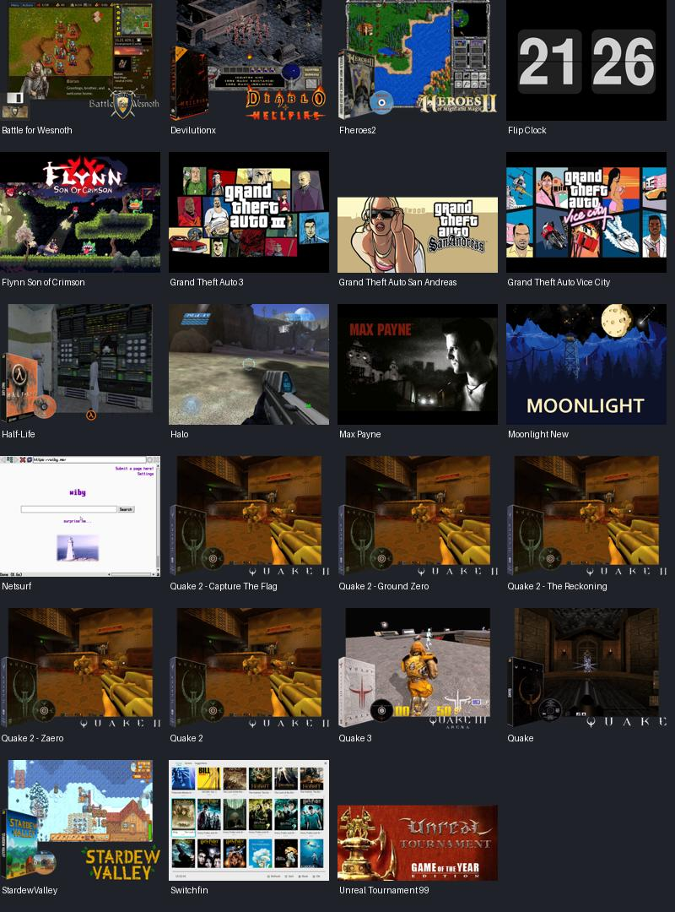

# PortMaster Game Covers for muOS

Cover images for **23 PortMaster game and application launchers** in the muOS Ports menu. Tested on an **Anbernic RG40XX H running muOS**.

[**Download artwork ZIP**](muOS_Ports_23_images.zip?raw=true)

## Installation

1. Download and extract `muOS_Ports_23_images.zip` on your phone or computer.
2. Open the muOS web file manager and navigate to:

   **Primary Storage → MUOS → info → catalogue → External - Ports → box**

3. Choose **Upload Files** and upload the **PNG files inside the extracted `box` folder**. Do not upload the ZIP itself into `box`.
4. Skip any existing images you want to keep.
5. On the handheld, leave the Ports menu and open it again.

No changes to game files or launch scripts are required.

### Filename matching

The image name must match the launcher's filename, replacing `.sh` with `.png`. Preserve spaces, punctuation and capitalization.

| Launcher | Image |
| --- | --- |
| `Grand Theft Auto San Andreas.sh` | `Grand Theft Auto San Andreas.png` |
| `StardewValley.sh` | `StardewValley.png` |

If you renamed a launcher, rename its PNG to match.

## Included entries

- Battle for Wesnoth
- Devilutionx
- Fheroes2
- Flip Clock
- Flynn Son of Crimson
- Grand Theft Auto 3
- Grand Theft Auto San Andreas
- Grand Theft Auto Vice City
- Half-Life
- Halo
- Max Payne
- Moonlight New
- Netsurf
- Quake 2 - Capture The Flag
- Quake 2 - Ground Zero
- Quake 2 - The Reckoning
- Quake 2 - Zaero
- Quake 2
- Quake 3
- Quake
- StardewValley
- Switchfin
- Unreal Tournament 99

## Appearance and limitations

- This is a collected artwork pack, not a set of newly drawn images.
- Some images combine a screenshot, a 3D box, a disc and a logo. Others are banners or screenshots; the pack does not have one uniform style.
- Quake II: Capture The Flag, Ground Zero, The Reckoning and Zaero currently use the same artwork as Quake II.
- Images are PNG files on a 320 × 240 canvas. How large they appear depends on your muOS theme and artwork settings.
- Tested in one user's setup; other versions and themes have not been verified.

## Troubleshooting

If an image does not appear:

1. Check that the PNG is directly inside `External - Ports/box`, not inside another `box` folder.
2. Check that its filename matches the `.sh` launcher exactly, apart from the extension.
3. Clear any search text in the web file manager: its filter can hide the folder contents.
4. Leave and reopen the Ports list.

## Sources and credits

| Entries | Image source |
| --- | --- |
| Battle for Wesnoth, DevilutionX, Flynn: Son of Crimson, Half-Life, Max Payne, Moonlight New, NetSurf, Flip Clock, Switchfin, Quake, Quake II and Quake III | [PortMaster-New](https://github.com/PortsMaster/PortMaster-New/tree/main/ports) |
| Grand Theft Auto III and Vice City | [nosro1/ports](https://github.com/nosro1/ports/tree/main/images) |
| Halo | [Halo CE handheld port](https://github.com/kirklandsig/halo-ce-anbernic-rg35xx) — `port/knulli/portmaster/screenshot.png` |
| Grand Theft Auto: San Andreas and Unreal Tournament | Steam store artwork, app IDs 12120 and 13240 |
| Fheroes2 and Stardew Valley | Existing artwork supplied from the tested handheld; original artist attribution is not known |

Game artwork and trademarks belong to their respective owners. No ownership of the original artwork is claimed, and no blanket license is granted for third-party images. This repository contains images and installation instructions only; it includes no game data.

This is an unofficial community collection, not an official muOS or PortMaster release.
